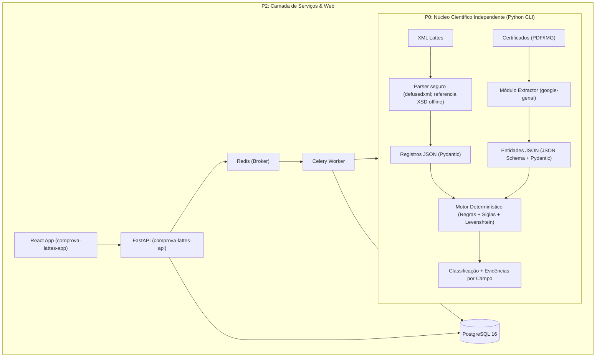

# Arquitetura do Sistema — Comprova Lattes

**Estado atual:** M1–M6 implementados e verificados offline, incluindo revisão humana AD-013 e frontend com lint/build. O diagrama mostra o fluxo implementado e a topologia de serviços prevista para execução real; PostgreSQL/Redis/Gemini reais não foram exercitados nesses gates. Sem estudo experimental oficial ou calibração aprovada; requisito DTD continua aberto. Gates em [quality.md](../../docs/quality.md).

## Visão em Camadas (Prioridade P0 → P2)

## Módulos Independentes (`comprova-lattes-api/src/comprova_lattes/`)

1. **`parser/`**: Lê o XML do Currículo Lattes de forma segura (`defusedxml`), trata codificações (`UTF-8` e `ISO-8859-1`) e converte as 5 categorias de AD-012 em modelos Pydantic padronizados (três seções iniciais e duas categorias de produção técnica). XSD oficial do Extrator é a referência estrutural; requisito DTD do orientador e equivalência com exportação UI permanecem pendentes (AD-011).
2. **`extractor/`**: Chama a API do Google Gemini (`google-genai`) para documentos PDF/imagem, aplica validação estrutural (`JSON Schema` + `Pydantic`) e registra metadados de reprodutibilidade (modelo, versão, temperatura, tokens).
3. **`matcher/`**: Motor 100% determinístico. Normaliza textos, aplica tabela de equivalência de siglas institucionais, calcula Distância de Levenshtein normalizada e classifica em `Validado`, `Divergente` ou `Inconclusivo` com justificativa auditável por atributo.
4. **`experiments/`**: Gerador stdlib de XML e PDF raster/PNG, 25 casos por família indivisível, cinco categorias e cinco operadores; siglas explícitas por emissor, edição leve e mutações factuais de carga/ano/titular/instituição. CLI dos Experimentos 1–3 com replay/injeção, métricas JSON, bootstrap por família, McNemar exato/Holm e congelamento SHA-256. Não usa HTML/DOCX; 30 piloto/~90 finais continuam proposta sem distribuição aprovada. Um registro por XML, sem competição multirregistro nesta bancada.
5. **`api/` & `worker.py`**: Camada web assíncrona em FastAPI + Celery/Redis + PostgreSQL para upload e consulta pela interface web.

## Revisão humana implementada (AD-013)

Inconclusivos são encaminhados à revisão; validados/divergentes podem ser revisados por solicitação. API/interface apresentam documentos, candidatos e evidências e registram revisor declarado, data, parecer e justificativa em histórico separado do snapshot automático. Associação pode ser corrigida usando documento do lote ou rejeitada. Sumários automáticos e após intervenção são contagens operacionais separadas, sem substituir métricas científicas pré-revisão. Formulário ressincroniza o último parecer ao reabrir. Sem autenticação de revisor, migrações ou recuperação de jobs interrompidos; testes usam SQLite em memória e tarefa/dispatcher local. Contrato em [proposal.md](../features/m2-matcher/proposal.md).

## Regra Arquitetural Inegociável

- `matcher/` **nunca** importa ou chama `google-genai`.
- `extractor/` **nunca** decide se um documento valida o currículo.
- Os módulos `parser/`, `matcher/` e `experiments/` devem funcionar via CLI e `pytest` mesmo sem o Docker (`PostgreSQL`/`Redis`) estar rodando.
