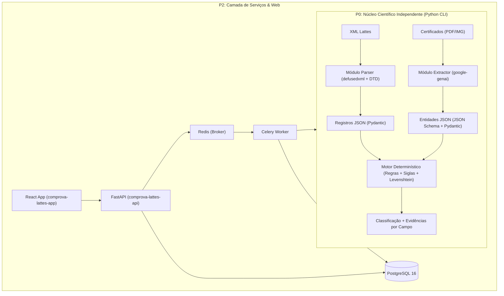

# Arquitetura do Sistema — Comprova Lattes

## Visão em Camadas (Prioridade P0 → P2)

## Módulos Independentes (`comprova-lattes-api/src/comprova_lattes/`)

1. **`parser/`**: Lê o XML do Currículo Lattes de forma segura (`defusedxml`), trata codificações (`UTF-8` e `ISO-8859-1`) e converte as 3 seções-alvo em modelos Pydantic padronizados.
2. **`extractor/`**: Chama a API do Google Gemini (`google-genai`) para documentos PDF/imagem, aplica validação estrutural (`JSON Schema` + `Pydantic`) e registra metadados de reprodutibilidade (modelo, versão, temperatura, tokens).
3. **`matcher/`**: Motor 100% determinístico. Normaliza textos, aplica tabela de equivalência de siglas institucionais, calcula Distância de Levenshtein normalizada e classifica em `Validado`, `Divergente` ou `Inconclusivo` com justificativa auditável por atributo.
4. **`experiments/`**: Gerador da bancada sintética (30 casos piloto + ~90 finais via templates HTML/DOCX) e scripts para os Experimentos 1, 2 e 3 (gerando matrizes de confusão $3 \times 3$ e métricas em CSV/JSON).
5. **`api/` & `worker.py`**: Camada web assíncrona em FastAPI + Celery/Redis + PostgreSQL para upload e consulta pela interface web.

## Regra Arquitetural Inegociável

- `matcher/` **nunca** importa ou chama `google-genai`.
- `extractor/` **nunca** decide se um documento valida o currículo.
- Os módulos `parser/`, `matcher/` e `experiments/` devem funcionar via CLI e `pytest` mesmo sem o Docker (`PostgreSQL`/`Redis`) estar rodando.
