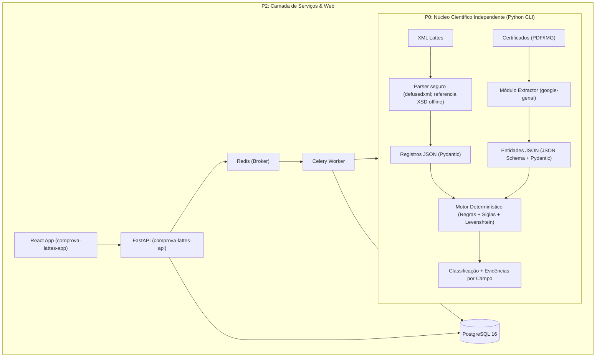

# Arquitetura do Sistema — Comprova Lattes

**Estado atual:** M1–M6 implementados e verificados offline, incluindo revisão humana AD-013 e frontend com lint/build. O diagrama mostra o fluxo implementado e a topologia de serviços prevista para execução real; PostgreSQL/Redis/Gemini reais não foram exercitados nesses gates. Sem estudo experimental oficial ou calibração aprovada; requisito DTD continua aberto. Gates em [quality.md](../../docs/quality.md).

## Visão em Camadas (Prioridade P0 → P2)

## Módulos Independentes (`comprova-lattes-api/src/comprova_lattes/`)

### Política operacional Gemini (2026-11-15)

`GEMINI_TIMEOUT_MS` (padrão 120000, faixa 1000–300000) e
`GEMINI_MAX_ATTEMPTS` (padrão 2, faixa 1–3) controlam chamadas criadas por
`GeminiExtractor.from_settings`. SDK tem retentativa desativada nesse cliente;
o extrator controla as tentativas e registra número/status ou tipo de erro/código
HTTP em `raw_metadata.attempts`, sem mensagens sensíveis. Espera exponencial com
jitter somente para 408/429/500/502/503/504 e erros de rede/timeout HTTP. Erros de
contrato ou 400/403 não são repetidos. Timeout é por tentativa; limite total pode
chegar a tentativas × timeout mais espera. Chamadores que injetam cliente próprio
devem configurar seu timeout e desativar retries do SDK para evitar multiplicação.

Gemini 2.x mantém temperatura zero; Gemini 3+ e identificadores desconhecidos omitem
o parâmetro, registrando `temperature=null` e `temperature_policy=provider_default`.
Google documenta que 3.6+ ignora o parâmetro e recomenda defaults nos demais 3.x.
`GEMINI_TEMPERATURE=0.0` permanece aceito por compatibilidade com o .env; não significa
controle efetivo em 3+. Não alterado o modelo local nem o esforço de raciocínio.
Uso de defaults não garante determinismo; protocolo/monografia precisam refletir isso.

M3 envia `ExtractionPayload.model_json_schema()` em `response_json_schema` do SDK,
mantendo `additionalProperties: false` e validação local. O caminho legado
`response_schema` apresentou 400 por `additional_properties` na primeira integração
real (SDK 3.3.0). Teste de transporte inspeciona o JSON serializado sem rede.

1. **`parser/`**: Lê o XML do Currículo Lattes de forma segura (`defusedxml`), trata codificações (`UTF-8` e `ISO-8859-1`) e converte as 5 categorias de AD-012 em modelos Pydantic padronizados (três seções iniciais e duas categorias de produção técnica). XSD oficial do Extrator é a referência estrutural; requisito DTD do orientador e equivalência com exportação UI permanecem pendentes (AD-011).
2. **`extractor/`**: Chama a API do Google Gemini (`google-genai`) para documentos PDF/imagem, aplica validação estrutural (`JSON Schema` + `Pydantic`) e registra metadados de reprodutibilidade (modelo, versão, temperatura, tokens).
3. **`matcher/`**: Motor 100% determinístico. Normaliza textos, aplica tabela de equivalência de siglas institucionais, calcula Distância de Levenshtein normalizada e classifica em `Validado`, `Divergente` ou `Inconclusivo` com justificativa auditável por atributo.
4. **`experiments/`**: Gerador stdlib de XML e PDF raster/PNG, 25 casos por família indivisível, cinco categorias e cinco operadores; siglas explícitas por emissor, edição leve e mutações factuais de carga/ano/titular/instituição. CLI dos Experimentos 1–3 com replay/injeção, métricas JSON, bootstrap por família, McNemar exato/Holm e congelamento SHA-256. Não usa HTML/DOCX; 30 piloto/~90 finais continuam proposta sem distribuição aprovada. Um registro por XML, sem competição multirregistro nesta bancada.
5. **`api/` & `worker.py`**: Camada web assíncrona em FastAPI + Celery/Redis + PostgreSQL para upload e consulta pela interface web.

## Revisão humana implementada (AD-013)

### Equivalência institucional por documento (AD-014, 2026-11-15)

O prompt `entities-v2` acrescenta ao contrato M3 o campo opcional
`issuer_name_acronym_evidence`: trecho literal que relaciona explicitamente
`issuer_institution` e `issuer_acronym` ao mesmo emissor. Nome/sigla isolados não
comprovam essa relação. Pydantic exige ambos no trecho por tokens normalizados;
essa checagem estrutural não prova fidelidade ao PDF, que deve ser avaliada no piloto.
O extrator não expande siglas por conhecimento externo nem classifica registros.

No modo PROPOSED, M2 usa a relação apenas no par com esse documento e registra
`DOCUMENT_ACRONYM_EQUIVALENCE`, trecho em `document_evidence` e justificativa visível
na auditoria. Todos os identificadores institucionais declarados no registro devem
concordar com a relação; ela não encobre nome completo distinto. Sem essa evidência,
permanece o dicionário fixo versionado. Sigla isolada desconhecida sem correspondência
gera `UNKNOWN_INSTITUTION_ACRONYM` / inconclusão por campo. Baselines preservam suas
regras exatas/normalizadas. Não há atualização de dicionário nem aprendizagem entre
documentos. Payloads anteriores continuam aceitos com evidência ausente.

Inconclusivos são encaminhados à revisão; validados/divergentes podem ser revisados por solicitação. API/interface apresentam documentos, candidatos e evidências e registram revisor declarado, data, parecer e justificativa em histórico separado do snapshot automático. Associação pode ser corrigida usando documento do lote ou rejeitada. Sumários automáticos e após intervenção são contagens operacionais separadas, sem substituir métricas científicas pré-revisão. Formulário ressincroniza o último parecer ao reabrir. Sem autenticação de revisor, migrações ou recuperação de jobs interrompidos; testes usam SQLite em memória e tarefa/dispatcher local. Contrato em [proposal.md](../features/m2-matcher/proposal.md).

## Regra Arquitetural Inegociável

- `matcher/` **nunca** importa ou chama `google-genai`.
- `extractor/` **nunca** decide se um documento valida o currículo.
- Os módulos `parser/`, `matcher/` e `experiments/` devem funcionar via CLI e `pytest` mesmo sem o Docker (`PostgreSQL`/`Redis`) estar rodando.
